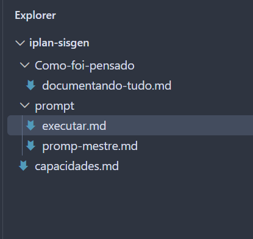

1 - pegamos o prompt e levamos para o chatgpt para avaliar o prompt.
https://chatgpt.com/share/6ac0dfa8-c62c-83e9-87ae-722c7c61359b

aqui nesse link temos todas as atividades realizadas

2 - no computado de casa, criei a pasta iplan-sisgen como pasta de projeto
Dentro dela criae diretorio Como-foi-pensado que vai registrar todas asações realizadas

3 - criei a pasta prompt e colei o prompt gerado pelo chatgpt em prompt-mestre.md

4- copie oarquivo capacidades para a raiz do projeto iplan-sisgen

5 - entrar no opencode (no VSCODE abri um terminal e digitei opencode) e executar C:\iplan-sisgen\prompt\executar.md

6 - antes de executar note que o nosso projeto tem essa estrutura image.png

7 - identificamos que as regras de negócios não estava no projeto. Então como a geração parou nantes da primeira fase eu copiei as regras de negocios para C:\iplan-sisgen\regras-negocios
E dei OK, no opencode

8- tive que dar ctl+c no opencode para iniciar, pois as regras de negocios não estavam no diretorio.

9 - após terminar a fase 1, opencode para e pediu OK para ir para fase 2.
dei o comando OK >capacidade1-fase2.md

é imprecindivel que a análise humana seja executada visto que o opencode fica aguardadndo uma decisão:

FASE 2

## RESUMO DA FASE 2

- **Telas analisadas**: 15
- **Regras de negócio identificadas**: ~180
- **Entidades mapeadas**: 13
- **Operações funcionais**: CRUD em ~10 telas; Consulta/Transferência em ~5
- **Relacionamentos**: ~13 identificados
- **Validações**: Unicidade, obrigatoriedade, referencial, formato
- **Cálculos**: Código sequencial, período automático
- **Fluxos**: Inclusão, alteração, exclusão, transferência, substituição
- **Conflitos/Inalcançáveis**: 7 cenários onde lógica não permite execução
- **Lacunas de Conhecimento**: ~25 questionamentos ([?])
- **Itens Inferidos**: ~5 (requerem validação)
- **Itens Não Identificados**: ~8 (sem evidência)

INFERIDOS
**DOCUMENTADO** | Origem: C192T, C806T

- **Órgão** ou **Tipo de Órgão**: Chave, preenchido automaticamente
- **Dia**: 2 dígitos, conferido como número
- **Mês**: 2 dígitos, conferido como número
- **Ano**: 4 dígitos, entre 1994 e 2099
- **Descrição**: 40 caracteres, obrigatória em inclusão e alteração
- **Marca**: Campo de linha (I, A, E)

**Capacidade**: 10.000 feriados por tipo (C192T); 100.000 feriados por órgão (C806T) (declarados)

**INFERIDO**: Dois cadastros de feriados existem, possível redundância

### Conflitos e Inalcançáveis

**INFERIDO** | Comportamento contraditório nas evidências

1. **C023T — RN-07**: Alteração é inalcançável
   - Conferência de código não encontra: "Bairro nao cadastrado"
   - Conferência de descrição encontra: "<- bairro ja cadastrado"
   - Resultado: Nenhum caminho permite alterar

2. **C025T — RN-09**: Inclusão pode ser recusada mas não reconfere em gravação
   - Não está claro se recusa de linha impede gravação de página inteira

3. **C147T — RN-05**: Alteração requer fonte informada igual à registrada
   - Ramo que muda fonte é inalcançável
   - C146T (outra tela) aceita a troca; divergência entre telas

4. **C162T — RN-04**: Linha recusada interrompe conferência, mas gravação roda depois?
   - Não está claro se recusa bloqueia gravação

5. **C172T — RN-09**: Marca de inclusão em linha, mas nunca é atribuída
   - Inclusão é inalcançável por esta jornada

6. **C192T / C806T**: Dois cadastros de feriados existem
   - Um por tipo de órgão (C192T, A010T)
   - Outro por órgão (C806T, A010T)
   - Possível redundância ou especialização não documentada

7. **C225T — RN-14**: Abertura de período sob condição que nenhuma tela produz
   - Período antigo é encerrado, mas novo não abre
   - Órgão sai da relação sem mudar de coordenação

**NÃO IDENTIFICADO**

- Comportamento de limite de página (releitura encadeada com posicionadores de leitura do ambiente)
- Comportamento de "segunda cópia" de sessão em C226C
- Significado exato de "origem" em C806T
- Processamento da transferência de registros em C226T (qual sistema executa)
- Catálogo de "trabalhos de lote" que dispara processamento

FASE 3
#### C023T — Bairros

**Razão**: RN-07 identifica alteração como inalcançável
- Conferência por código não encontra: "Bairro nao cadastrado"
- Conferência por descrição encontra: "<- bairro ja cadastrado"
- Nenhum caminho permite alterar

**Decisão Necessária**: 
- Implementar apenas incluir e excluir?
- Ou resolver conflito nas regras?

#### C172T — Períodos de Referência

**Razão**: RN-09 identifica marca de inclusão como não preenchida
- Marca de inclusão é exigida, mas nunca é atribuída por menu
- Inclusão fica inalcançável

**Decisão Necessária**:
- Como a marca é preenchida em produção?
- Ou implementar apenas consulta?

#### C225T — Transferência de Órgãos

**Razão**: RN-14 tem condição não produzida
- Abertura do período novo e mudança do órgão estão sob condição
- Período antigo é encerrado, mas novo não abre
- Órgão não muda de coordenação

**Decisão Necessária**:
- Qual é a condição que dispara abertura e mudança?
- Pode haver problema na evidência?

#### C023T — Bairros

**Razão**: RN-07 identifica alteração como inalcançável
- Conferência por código não encontra: "Bairro nao cadastrado"
- Conferência por descrição encontra: "<- bairro ja cadastrado"
- Nenhum caminho permite alterar

**Decisão Necessária**: 
- Implementar apenas incluir e excluir?
- Ou resolver conflito nas regras?

8 - ao PARE , após verificar se há pendencias, é dados OK >capacidade X-faseY.md

9 - após conlcuir o projeto foi solicitado para gerar README.md

10 - no opencode fiz uma pergunta

me resuma quais os passo devo seguir para colocar a aplicação no ar, com windows.
Se tiver que criar um ambiente python, me informe como fazer com base no que foi dsenvolvido. Somente para windows me forneça passo a passo com os comando que devo utilizar para colococar o sistema no ar > resposta-pergunta-como-app-no-ar.md